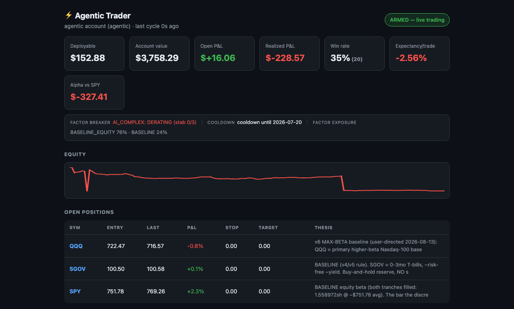
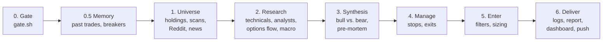

# Agentic Trader

An autonomous LLM agent that researched stocks and traded a small real-money brokerage account four times a day for eight weeks (June–August 2026), plus the evaluation tooling that showed its stock picking didn't work.

I designed the system, wrote its rules, made every go/no-go decision, and ran it with my own money. Most of the code and protocol text was written with [Claude Code](https://claude.com/claude-code) as a coding partner.

> Educational project, not financial advice. Account numbers, order IDs and other private details have been removed from every file.

## At a glance

| | |
|---|---|
| **Runs** | 150 scheduled cycles, Jun 26 – Aug 19, 2026: 34 deep research runs and 101 check-ups |
| **Broker access** | Robinhood's MCP (Model Context Protocol) connector: quotes, stock screens, positions, order review, order placement |
| **Agent** | Claude, running in the Claude desktop app, following a ~900-line written protocol |
| **Code** | Bash safety gate, Python dashboard generator, JSONL logs |
| **Outcome** | Live picks lost money and trailed a buy-and-hold S&P 500 (SPY) benchmark. The evaluation layer caught it, and live picking was frozen |

## How one cycle works

| Phase | What happens |
|---|---|
| 0. Gate | `code/gate.sh` prints JSON saying whether live orders are allowed (armed/kill-switch files, market session, NYSE holiday calendar). The agent must copy it exactly. |
| 0.5. Memory | Reads past trades and lessons. Applies the drawdown circuit breaker and the cooldown after a losing streak. |
| 1. Universe | Current holdings, trending r/wallstreetbets tickers (Ape Wisdom API), a Robinhood momentum scan, sector leaders, news. |
| 2. Research | Macro context, analyst targets, unusual options activity, technical indicators (RSI, ATR, MACD), earnings dates, option chains. Deep runs write a full write-up on each finalist. |
| 3. Synthesis | Five "desks" (quant, macro, catalyst, sentiment, risk) argue a bull and a bear case, followed by a pre-mortem. |
| 4. Manage | Re-checks every open position: stops, trailing stops, exits. |
| 5. Enter | Filters, then position sizing. Orders are reviewed with the broker before they're placed. |
| 6. Deliver | Appends to the logs, writes a Markdown report, rebuilds the dashboard, and sends a phone notification (ntfy). |

The full rulebook is in [`protocol/trade-cycle-protocol.md`](protocol/trade-cycle-protocol.md).

## Design choices

- **A deterministic gate instead of the model's word.** Early on, the agent's reports said "dry run" while live orders were actually filling. Now a shell script decides whether trading is allowed, and the protocol requires the agent to follow its output.
- **Hard risk limits:**
  - at most 6% of capital at risk per trade, and at most 40% in one stock
  - reward-to-risk of at least 2:1
  - a drawdown circuit breaker that halts new entries 12% below the account's high
  - caps on exposure to one sector or theme
  - a cooldown after consecutive losses
- **Anti-chase filter:** no buying a stock that's already up about 5% on the day, or at a fresh high while its sector is selling off.
- **Factor circuit breaker:** when a whole theme (for example, AI chip stocks) is selling off, no new positions in it until it has stabilized for three sessions.
- **Everything is logged.** Every decision, trade, equity snapshot and lesson goes to JSONL files, so performance comes from the log, not from the model's memory.

## Evaluation

- **Dashboard** (`code/dashboard.py`): the equity curve, open positions, win rate, realized P&L, expected return per trade, and the dollar gap versus simply holding SPY. The big step down in the equity curve is a $500 withdrawal, not a loss. The benchmark is adjusted for it.
- **Shadow ledger** (`sample-data/shadow.jsonl`): every trade idea rejected at the final gate is logged with the entry, stop and target it would have used. Five or more trading days later it's graded by which it hit first, stop or target. That measures whether each filter is helping.
- **Calibration and slippage:** each trade logs the model's 1–10 confidence score and the gap between the decision price and the actual fill.

## Results

By the seven-week review (Aug 12, 2026), the live picks had closed 10 positions: 2 wins and 8 losses, with a profit factor of 0.15. The account was down 7.7% while SPY was up 4.3%.

What the evaluation found:

1. **A unit bug was hiding the losses.** One trade stored its return as 8.08 (percent) while every other row used decimals (−0.0817). Averaged together, it made the dashboard show **+0.34%** per trade when the real figure was **−3.37%**. Fixed by normalizing on read.
2. **Going live switched off the learning loop.** Paper tracking only ran in dry-run mode, so seven weeks of rule changes were judged on just 10 trades.
3. **Confidence scores were backwards.** Every trade the model rated 7/10 or higher lost. Both winners were rated 6.5.
4. **The filters were the part that worked.** The factor breaker blocked 17 trades that would have lost and 3 that would have won. The anti-chase filter blocked 6 eventual losers and no winners. The weak part was picking entries.

What I did about it:
- Froze new live picks.
- Moved the rest of the account into index funds.
- Started a 30-trade paper test with a pass/fail rule set in advance: resume live trading only if expected return is above 0 and profit factor is above 1.2.

## What I'd do differently

- Paper-trade until there's evidence of an edge, then go live.
- Check whether confidence scores predict anything before sizing positions on them.
- Keep the learning loop running in every mode.
- Start from a simple baseline (buy and hold the index) and make every change prove it beats that.

## What's in this repo

| Folder | Contents |
|---|---|
| `protocol/` | The rulebook the agent follows every cycle |
| `code/` | `gate.sh` (safety gate), `dashboard.py` (dashboard generator), `notify.sh` (phone notifications) |
| `sample-data/` | The real trade ledger, equity snapshots, shadow ledger, paper trades and lessons (private IDs removed) |
| `sample-reports/` | Three reports the agent wrote: a deep research run, a strategy review, and a check-up |
| `images/` | Dashboard screenshot |

This isn't a standalone program. It's a protocol that Claude follows inside the Claude desktop app with Robinhood's connector enabled, and the files in `code/` are helpers it calls. An earlier Python version and the bot before it aren't included.
